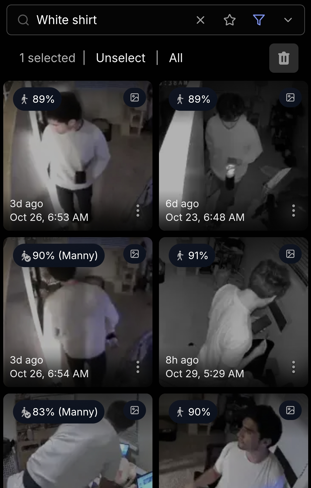

> Cover photo blurred to protect my location.

## Intro

I don't love handing over my sensitive data to Big Tech. When I considered getting a home surveillance system to watch my cat, I worried about where that data was ending up.

So I thought why not keep it local.

After a bit of research I found [Frigate NVR](https://frigate.video/) which addressed all my concerns and came with some pretty powerful features to play with.

Below I talk about how I configured Frigate with object detection, face recognition, and more on afforadable hardware!

## Hardware

### Cameras

Prices below as of 2026:

    - 4x Tapo C101 (Used on Amazon - $50)
    - 2x Tapo C217 (Amazon - $60)

Im using the C101 camera model indoors and the C217 outdoors. 

Both of these models support RTSP; the C217 also supports pan/tilt features over ONVIF. 
  

### PC Hardware

You will want a mid-range PC with a decent GPU or a Raspberry Pi to run Frigate.

Object detection will be best with an AI Coprocessor. If you dont have one but want to test out detection, you could also configure a dedicated GPU to run a lightweight model.

I'm using the Google Coral TPU USB Accelerator (Amazon - ~$100) to run my object detection. This is only one option of many. See [Frigate](https://docs.frigate.video/configuration/object_detectors) docs for more.

My GPU is an NVIDIA GeForce RTX 2060 purchased nearly 10 years ago. All I need it for is rendering the camera stream, but it handles lightweight AI models just fine through the [ONNX](https://docs.frigate.video/configuration/object_detectors/#onnx) format.

Total cost for cameras and AI Coprocessor: **$210.00**

## Software

### PC Environment

#### Docker

Frigate runs on [Docker](https://docs.docker.com/get-started/docker-overview/). Some experience here will go a long way, but it's doable for a beginner and Frigate thorough [documentation](https://docs.frigate.video/frigate/installation/#docker).

Make sure you're comfortable with creating containers with a docker-compose.yaml config file, bind mounting, port mapping, and reading the build time logs. These skills will be helpful if things go south.

#### Operating System

My flavor of Linux is CachyOS. I find Linux a bit more compatible with Docker, but I've also spun up Frigate containers in Windows no problem. 

#### Storage

You're gonna want a good amount of storage reserved for the detections and recordings. It all depends on what you choose to record/detect. I have 500GB reserved, but I only save recordings for 72 hours so I rarely cross 200GB of utilization.e

#### Tailscale

Spinning up a container on your home PC is great for keeping your data local, but it's not very useful if you can't deploy outside your home network.

That's where [Tailscale](https://tailscale.com/docs/concepts/what-is-tailscale) comes in!

Tailscale lets me set up a private network, aka [Tailnet](https://tailscale.com/docs/concepts/tailnet), where I can control who gets in through a convenient desktop or mobile app. That way I can route my home network traffic through a [Zero Trust](https://tailscale.com/docs/concepts/zero-trust) connectivity platform to devices pretty much anywhere.

I won't bother going over set up of Tailscale; it's quite painless. Just make sure you read up on [security](https://tailscale.com/docs/reference/best-practices/security) and understand the risks.

### Cameras

The Tapo cameras require you to create an account for setup. After the initial setup, the cameras stream directly to TP-Links proprietary cloud platform. 

Disgusting behavior, in my opinion. 

I opted to configure RTSP streams and route them locally, while preventing the cameras from directly accessing the internet.

**NOTE: TP-Link does not make it easy to keep the camera streams isolated from external servers. If it were up to me this would be a toggle switch.** 

then configure . 

In order to prevent camera streams from reaching Tapo servers, you must configure each camera with a a static IP for each camera and a bad gateway after setting up the RTSP streams in Frigate. 

**Configuring a bad IP will immediately kick the cameras "offline", but you can keep tapping into the RTSP streams.**

Now you have camera streams a wireless camera stream, and the data stays right on your network!

### Object Detection

**Note:** In order to use object detection you must also configure motion detection.

The quality of your object detections is going to be dependent on a few key parameters:

    - Model Choice
    - Input Resolution
    - Variant Size (if using YOLOv9 models)

I'm using the *small* variant of YOLOv9 with an input resolution of 320x320. You might think running larger input resolution would produce better results, [but this is not the case](https://docs.frigate.video/configuration/object_detectors/#choosing-a-model-size).

320x320 actually has a better shot at detecting small objects than a 640x640 input; the model is only able to fit more objects into a single detection if the resolution is increased.

Once you've configured motion detection and object detection, Frigate will start handing over detections for review.

The categories of object Frigate will show you depend on what your model choice is capable of, the labels file you hand over to your model, and what you have configured Frigate to show you.

### Semantic Search

One of the coolest features available on Frigate is Semantic Search.

This feature takes object detections and runs them through another Local AI model (from Jina AI) which gives the images *embeddings*. These *embeddings* provide text descriptions of the image to group relevant images together.

From there, you can search through your database of detections based on the *embeddings*...

For example, here I search my detection database for the term "white shirt":

Just think of the possibilities!

### Face Recognition

Setting up facial recognition is very intuitive. Simply add some clear images of the subjects face and Frigate will start classifying people detected with sub_labels based on their face.

You can also train these facial detections easily and directly in the user interface. It is crucial you train based on a set of high quality images with diverse lighting, orientation, etc.

Training on a poor dataset will quickly degrade the quality of your classifications.

You also want to avoid training on images that were already classified with a relatively high score. This could lead to overfitting.

## Outro

So that's a brief write-up on how I'm using Frigate. There are still plenty of features I want to try out (object states, zones, license plate recognition, and more).

If I get the sense enough people care I may end up creating a full tutorial and sharing my anonymized configuration file and Docker Compose file.

*'til next time!*

