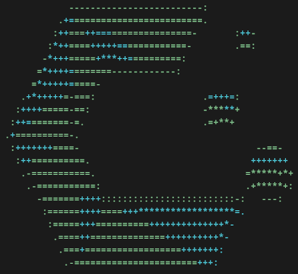
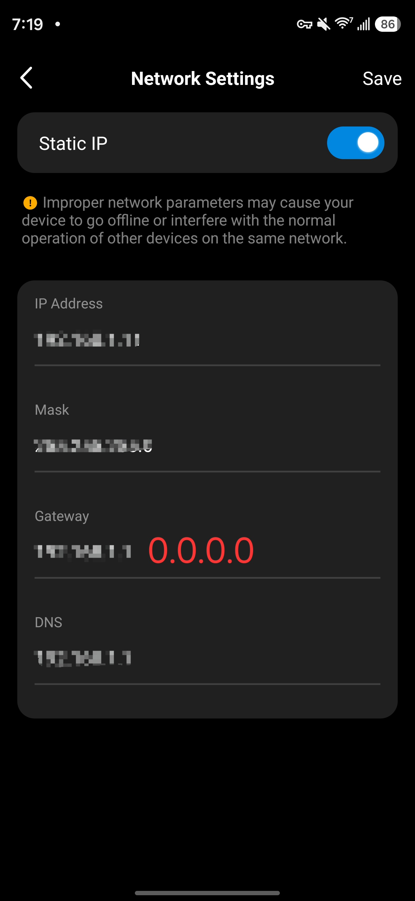

> Cover photo blurred to protect my location.

## Intro

I've don't love handing over my sensitive data to Big Tech. 

I won't get into that topic today, but it made me think twice when I thought about getting a home surveillance system to spy on my cat (named Fish).

After a bit of research I found [Frigate NVR](https://frigate.video/) which addressed all my concerns and came with some pretty powerful features to play with.

Below I talk about how I configured Frigate with object detection, face recognition, and more on afforadable hardware! Follow along if your trying to breakup with Big Tech too...

## Hardware

### Cameras

Prices below as of 2026:

    - 4x Tapo C101 (Used on Amazon - $50)
    - 2x Tapo C217 (Amazon - $60)

Im using the C101 camera model indoors and the C217 outdoors. 

Both of these models support RTSP; the C217 also supports pan/tilt features over ONVIF. 
  

### PC Hardware

You will want a mid-range PC or a Raspberry Pi to run Frigate. 

I recommend an EdgeTPU if you plan to run object detection. If you dont have one but want to test out detection, you could also configure a dedicated GPU to run a lightweight model.

I'm using the Google Coral TPU USB Accelerator (Amazon - ~$100) to run my object detection. This is only one option of many. See [Frigate](https://docs.frigate.video/configuration/object_detectors) docs for more.

My GPU is an NVIDIA GeForce RTX 2060 purchased nearly 10 years ago. This can be used to run lightweight object detection models, but im only using it for processing the footage.

Total cost for cameras and AI Coprocessor: **$210.00**

## Software

### PC Environment

Frigate runs on [Docker](https://docs.docker.com/get-started/docker-overview/). Some experience will go a long way, but it's doable for a beginner and Frigate has good [docs here](https://docs.frigate.video/frigate/installation/#docker) as well. 

I have yet to try Windows or MacOS. My flavor of Linux is CachyOS.

### Cameras

The Tapo cameras require you to create an account for setup. Upon initial setup, the cameras are configured to stream directly to TP-Links proprietary cloud platform. This is something I wanted to avoid in favor of using RTSP to receive streams locally and preventing the cameras from directly accessing the internet.

**NOTE: TP-Link does not make it easy to keep the camera streams isolated from external servers.** 

You must first create a TP-Link account to boot the cameras, create an RTSP stream account for each camera, then configure a static IP for each camera. 

In order to prevent camera streams from reaching Tapo servers, you must configure each camera with a bad gateway after setting up the streams in Frigate. 

**This will immediately kick the cameras offline according to the Tapo app, but you can keep tapping into the RTSP streams.**

Now you have camera streams over WiFi, and the data never leaves your network!

### Object Detection

**Note:** In order to use object detection you must also configure motion detection.

The quality of your object detections is going to be dependent on a few key parameters:

    - Model Choice
    - Input Resolution
    - Variant Size (if using YOLOv9 models)

I am using the *small* variant of YOLOv9 with an input resolution of 320x320. You might think running larger input resolution would produce better results, but this is not the case.

320x320 actually has a better shot at detecting small objects than a 640x640 input; the model is only able to fit more objects into a single detection if the resolution is increased.

Once you've configured motion detection and object detection, Frigate will start handing over detections to review.

The categories of object Frigate will show you depend on what your model choice is capable of, the labels file you hand over to your model, and what you have configured Frigate to show you.

### Semantic Search

One of the coolest features available on Frigate is Semantic Search.

This feature takes object detections and runs them through another Local AI model (from Jina AI) which gives the images *embeddings*. These *embeddings* provide text descriptions of the image to group relevant images together.

From there, you can search through your database of detections based on the *embeddings*...

For example, here I search my detection database for the term "white shirt":

# THIS POST IS STILL UNDER CONSTRUCTION

### COME BACK SOON!

